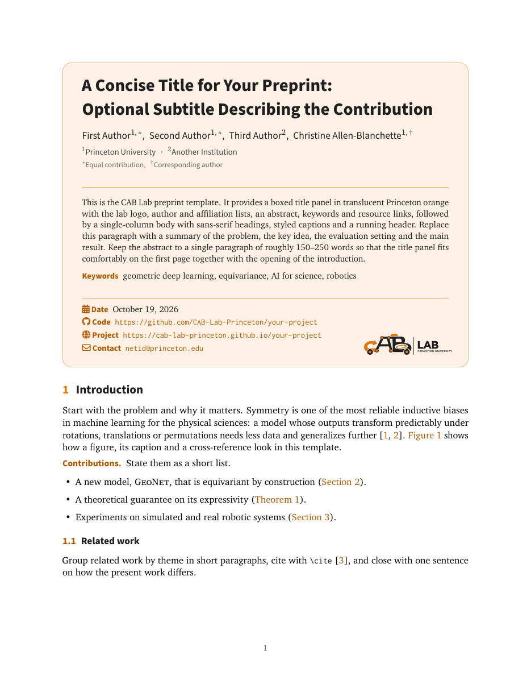
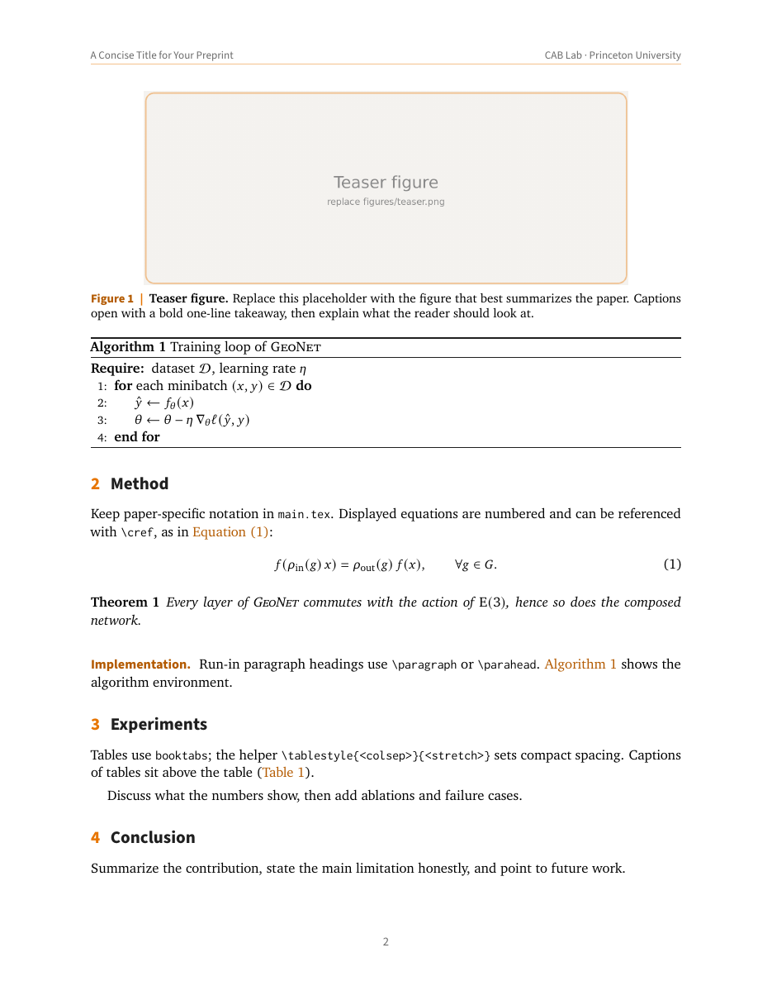

<p align="center">
  
</p>

<h1 align="center">CAB Lab Preprint Template</h1>

<p align="center">
  A LaTeX class for arXiv preprints from the CAB Lab at Princeton University.<br>
  Single-column, a boxed title panel in translucent Princeton orange, and it builds with plain <code>pdflatex</code>.
</p>

<p align="center">
  
  &nbsp;
  
</p>

<p align="center"><b><a href="docs/example.pdf">📄 Compiled example (PDF)</a></b></p>

## Quick start

```bash
git clone git@github.com:CAB-Lab-Princeton/PreprintTemplate.git my-paper
cd my-paper && rm -rf .git && git init
make            # or: latexmk -pdf main.tex
```

**Overleaf:** upload the folder as a zip (*New Project → Upload Project*). Set the compiler to pdfLaTeX, which is the default.

**arXiv:** run `make arxiv`. It writes `arxiv.tar.gz`, which bundles the sources, figures, logo and the generated `.bbl`. Upload that archive unchanged. Every font in the class ships with TeX Live, so arXiv compiles it without extra files.

## What is in the box

```
cablab.cls          the class. All styling lives here, so don't put paper content in it
main.tex            example paper: title block, \input of sections, bibliography
sec/                one file per section (abstract, intro, method, ...)
figures/            your figures (teaser.png is a placeholder)
assets/             lab logos (see below)
main.bib            bibliography
Makefile            make | make watch | make arxiv | make preview | make clean
```

## The title block

Put everything in the preamble, then call `\maketitle` right after `\begin{document}`.

```latex
\documentclass{cablab}

\title{A Concise Title:\\ Optional Subtitle}   % \\ picks the line break
\shorttitle{A Concise Title}                   % running header, pages 2+

\author[1,*]{First Author}
\author[1,\dagger]{Christine Allen-Blanchette}
\affiliation[1]{Princeton University}
\contribution[*]{Equal contribution}
\contribution[\dagger]{Corresponding author}

\begin{abstract}
  One paragraph, 150--250 words.
\end{abstract}
\keywords{geometric deep learning, equivariance}

\date{\today}
\arxiv{2610.01234}                                % arXiv id, once you have one
\code{https://github.com/CAB-Lab-Princeton/project}
\project{https://cab-lab-princeton.github.io/project}
\data{https://huggingface.co/datasets/...}
\correspondence{\email{netid@princeton.edu}}
\metadata[\faYoutube\ Video]{\href{https://...}{talk}}   % any custom row
```

Each metadata row is optional, and the rows print in the order you declare them. Superscripts in `\author[...]` are set in math mode, so `*`, `\dagger` and `\ddagger` all work.

## Class options

| Option | Effect |
|---|---|
| `11pt` *(default)*, `10pt`, `12pt` | body font size |
| `twocolumn` | two-column body. The title panel spans both columns ([preview](docs/preview-twocolumn-1.png)) |
| `toc` | *off by default.* Compact two-column table of contents under the title panel, with the body following directly. Suits papers of about 10 pages or fewer ([preview](docs/preview-toc-1.png)) |
| `tocpage` | *off by default.* One-column table of contents under the title panel, with the body starting on a new page. Suits surveys and long papers ([preview](docs/preview-tocpage-1.png)) |
| `nonatbib` | skip natbib, e.g. when the paper uses `cite.sty` or biblatex |
| `nologo` | hide the logo in the title panel |
| `noheader` | no running header on pages 2+ |
| `draft` | line numbers in the margin, for internal review |
| `a4paper` | any other option is passed through to `article` |

Fine-tuning goes in the preamble:

```latex
\panelopacity{0.14}                 % title-panel fill opacity (default 0.10)
\logowidth{3cm}                     % logo width in the panel (default 3.6cm)
\lablogo{assets/cablab-mark}        % a different logo file (no extension)
\headerright{Preprint. Under review.}
\toccolumns{1}                      % contents columns (toc: 2, tocpage: 1)
\setcounter{tocdepth}{1}            % contents depth (default 2 = subsections)
\tocnumwidths{2.4em}{3.2em}         % widen number boxes, e.g. for Roman numerals
```

You can also leave both options off and put `\tableofcontents` wherever you want it. It uses the same styling. References get a contents entry automatically.

## Writing helpers

| Command | Purpose |
|---|---|
| `\cref{...}` / `\Cref{...}` | cleveref is loaded, so references print as "Figure 1", "Section 2", "Equation (3)" |
| `\paragraph{Title}` or `\parahead{Title}` | bold orange run-in heading |
| `\tablestyle{6pt}{1.15}` | compact table: column gap, row stretch, `\small`, centred |
| `\cmark` / `\xmark` | ✓ / ✗ in tables |
| `\rowcolor{cabOrange!8}` | highlight "ours" rows |
| `\beginappendix` | starts the lettered appendix on a new page |
| colours | `cabOrange` (#E77500), `cabOrangeDark` (#B35A00, for text), `cabInk`, `cabGray` |

Captions read **Figure 1 | Caption**. Start each caption with a bold one-line takeaway. Table captions sit above the table.

Typography: XCharter for text, newtxmath (Charter) for maths, Source Sans Pro for headings, Inconsolata for code. All four are pdflatex Type 1 fonts from TeX Live.

## Lab logos

| File | Use |
|---|---|
| `assets/cablab-logo.png` | full lockup (default in the title panel) |
| `assets/cablab-logo-dark.png` | lockup for dark backgrounds |
| `assets/cablab-mark.png`, `cablab-mark-dark.png` | "CAB" monogram only |
| `assets/cablab-icon.png` | square icon: the monogram on a rounded tile (avatars, favicons) |

The letters C-A-B are drawn as a taxi cab, and each one stands for a research theme. The **C** is the hood, a rotation arrow (symmetry, equivariance, geometric deep learning). The **A** is the front cabin, a linkage of graph nodes (graph networks, robot kinematics). The **B** is the rear cabin and trunk, with an orbit inside (physics, AI for science). A taxi roof-light sits on top.

## Converting an existing paper

1. Replace `\documentclass{...}` with `\documentclass{cablab}`. Delete the old geometry, font, hyperref and caption setup, because the class already provides them.
2. Move the abstract into `\begin{abstract}...\end{abstract}` *before* `\maketitle`.
3. Two-column floats (`figure*`, `table*`) still work. `\columnwidth` now equals the full text width, so check figure sizes.
4. Tables sized for a 7.16in two-column page have about 6.5in here. Use `tabularx` with `X` columns, or `\small` / `\footnotesize`.
5. If the paper uses `cite.sty`, IEEEtran or venue macros, load the class with `nonatbib` and add small shims in the preamble. For an example, see the GA survey: `\newcommand{\IEEEPARstart}[2]{#1#2}`.

## Credits

The layout is adapted from the MIT-licensed [fairmeta](https://github.com/facebookresearch/metapaired) (Meta) and [arXivTeX](https://github.com/wanghao9610/arXivTeX) (Hao Wang) templates. [OneThree](https://github.com/choucisan/arXiv-Template) was also a reference. See [LICENSE](LICENSE).
